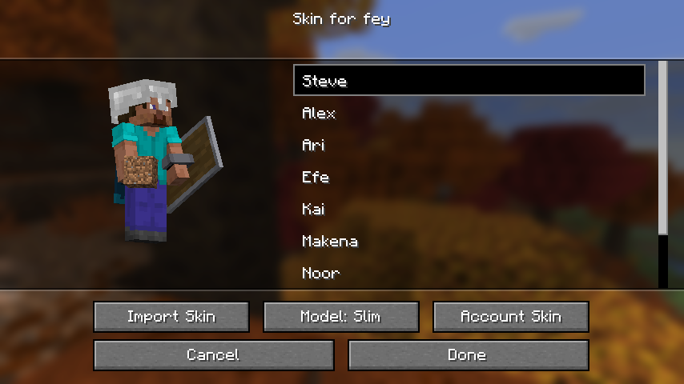
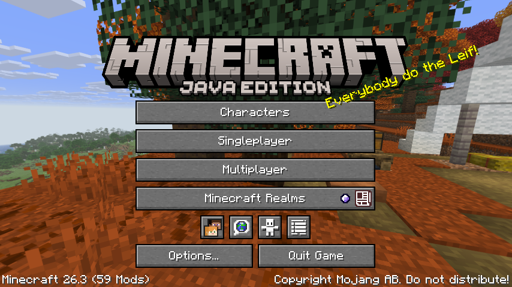

# Parallel Players

Adds Terraria-style character modularity to Minecraft. A character is a player of its own (inventory, experience,
health, statistics, advancements, name and skin) that you can take into any world. Pick a character
before you play and it comes with you or switch to another and pick up where that one left off.

Characters are stored locally, outside any world, so the same character can play in all your
singleplayer worlds and on servers that have the mod installed.


**Requires Minecraft 26.3, Fabric Loader and Fabric API.**

## Features

### Characters
- Create, rename, select and delete characters from the **Characters** button on the main menu.
- Each character has its own inventory, armour, experience, health, hunger, effects, ender chest,
  statistics and advancements.
- Characters remember where they last were in each world they have joined. A character that has never been to a world starts
  at spawn

### Your account
- Your Minecraft: Java Edition account is always the first entry in the list, and its what you play as by default.
- Playing as your account works like the game without the mod, each world keeps its own player individual data.
- Your account's data in a world is set aside while a character plays there and is given back when you
  play that world as your account again.



### Custom skins
- Giving a character their own skin either your active account skin, one of the default skins, or any skin you may want to import.

### Gamemodes
- Every character is sorted in a gamemode being Survival, Creative or Hardcore, chosen when it is created and stays fixed.
- A character can only enter worlds of its own kind, so creative progress never leaks into survival for example:
  - **Survival** characters join survival worlds with cheats disabled
  - **Creative** characters join worlds that are Creative or have cheats enabled
  - **Hardcore** characters join only hardcore worlds
- Opening a world that does not suit your selected character takes you to character selection, creating a world also offers to make a character for it.



### In-game
- Your character's name is used in chat, tab list, name tag, join, death and advancement messages, hovering over it
  will show the original player's username.

### Character backups
- Each character's player data is backed up automatically, keeping up to 5 copies by default, this is customizable!

### Servers and LAN
- On a server that has the mod, your active character comes with you. Players without the mod join as
  their account.

### Settings and permissions
- A settings screen, opened from [Mod Menu](https://modrinth.com/mod/modmenu) with various options to customize parallel players.
- Settings are kept in `config/parallel/client.json` and `config/parallel/server.json`.
- Servers can turn characters or gamemode rules off and set how often characters sync (`syncIntervalSeconds`)
  in `server.json`, and control who may use them with a
  permissions mod such as [LuckPerms](https://luckperms.net/):

  | Permission                  | Default   | Allows                                              |
  |-----------------------------|-----------|-----------------------------------------------------|
  | `parallel.characters.use`   | everyone  | playing as a character                              |
  | `parallel.gamemodes.bypass` | nobody    | taking a character into a world of another gamemode |
  | `parallel.usernames.see`    | operators | seeing the usernames of players on characters       |

## Locations

| What                                         | Where                                     |
|----------------------------------------------|-------------------------------------------|
| Your characters                              | `characters/` in the game folder          |
| Which character is selected                  | `characters/active_character.txt`         |
| A server's copies of its players' characters | `<world>/parallel/players/` on the server |
| Account data set aside in a world            | `<world>/parallel/accounts/`              |

## Building

```
./gradlew build
```

The mod jar is written to `build/libs/`. `./gradlew runClient` and `./gradlew runServer` start a
development client and server.

## License

[MIT](LICENSE)
